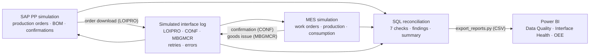
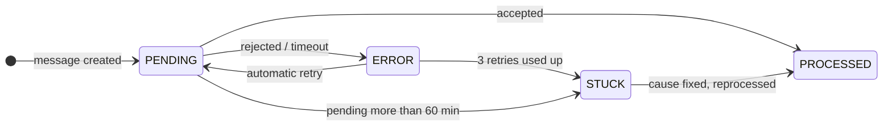
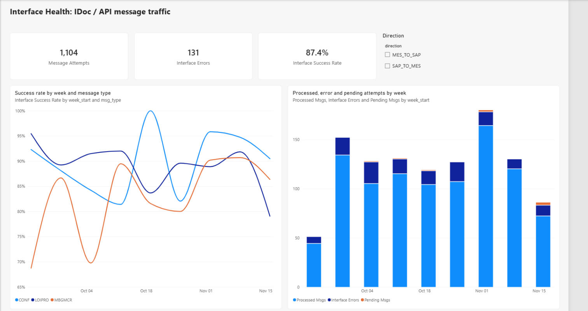
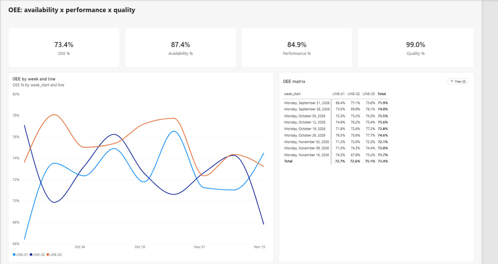

# SAP PP ↔ MES Integration & Data Validation

[](https://github.com/Akash3525/SAP-MES-Integration-Validation-/actions/workflows/tests.yml)

Seven SQL checks reconcile simulated SAP PP and MES data for 400 production orders and find exactly the 57 problems deliberately injected into them, with no false alarms. The repository also includes interface monitoring, OEE reporting and a Power BI dashboard. Fictional data; no live SAP connection.

https://github.com/user-attachments/assets/492277e1-26a5-4f08-a4fe-9cacf599f4fe

> Related project: [Pharmaceutical MES Portfolio](https://github.com/Akash3525/Pharmaceutical-MES-Portfolio), a simulated MES and electronic batch record with GMP rules enforced in PostgreSQL.

> **Scope note.** The data is simulated, and the table names are simplified. They are not real SAP tables such as AUFK, AFRU or RESB, and there is no live SAP or MES connection. The project shows the reconciliation logic and the testing approach a manufacturing IT or MES engineer would use.

## What it shows

| Area | What's in it |
|---|---|
| **Simulated systems** | SAP-side production orders, BOM components and confirmations, and MES-side work orders, production records and material consumption, for **400 fictional orders** |
| **Interface log** | IDoc/API-style message log (LOIPRO order download, CONF confirmation, MBGMCR goods issue) with processed, error and pending states, retry counts and error text |
| **7 validation checks** | SQL views: missing in MES, no SAP confirmation, duplicate MES orders, quantity mismatch, consumption mismatch, status mismatch, stuck messages |
| **Known-answer testing** | The generator injects **57 known problems**. The tests prove each check finds exactly those orders, with no misses and no false alarms |
| **Reporting** | Weekly interface health and OEE (availability × performance × quality) views, exported as CSVs for Power BI |
| **Runbook** | [Troubleshooting Playbook](docs/Troubleshooting_Playbook.md) for each check, a [worked example](docs/Troubleshooting_Example.md) and a [Power BI Guide](docs/PowerBI_Guide.md) |

## Architecture



Each interface message moves through this lifecycle. Every attempt is logged, so retries are visible:



`STUCK` is what the `stuck_messages` check reports; it is not a stored status.

## The seven checks

| # | Check | Finds | Example from the data | Injected |
|---|---|---|---|---|
| 1 | `missing_in_mes` | Released in SAP more than 24 h ago, never arrived in MES | 1000000068: created 2026-10-03, still not in MES | 8 |
| 2 | `no_sap_confirmation` | Complete in MES, no confirmation in SAP | 1000000038: MES complete since 2026-09-30, no confirmation | 9 |
| 3 | `duplicate_mes` | Same SAP order downloaded into MES more than once | 1000000158: two MES work orders (ids 154, 155) | 6 |
| 4 | `qty_mismatch` | MES good/scrap ≠ SAP confirmed yield/scrap | 1000000061: MES good 119,981 vs SAP 116,651 | 10 |
| 5 | `consumption_mismatch` | Component usage more than ±5 % from BOM, scaled to the quantity produced | 1000000106: EXC-300010 consumed 30.35 kg, expected 36.08 kg (−15.9 %) | 8 |
| 6 | `status_mismatch` | SAP CNF/TECO but MES not complete, or SAP still REL after confirmation | 1000000028: SAP CNF vs MES IN_PROGRESS | 7 |
| 7 | `stuck_messages` | Latest attempt pending more than 60 min, or failed with no retries left | 1000000011: goods issue failed 3 times, order locked (TECO) | 9 |

Thresholds live in the `validation_settings` table, so they can be tuned without changing the SQL.

The data also contains situations that **must not** be flagged, and the tests check this:
- orders created within the last 24 h that are still on their way to MES
- interface messages that failed with a transient error and then succeeded on retry
- consumption that differs from the BOM by less than 5 %

## Example output

```
$ python -m sapmes.run_validation
Check                   Findings
--------------------------------
missing_in_mes                 8
no_sap_confirmation            9
duplicate_mes                  6
qty_mismatch                  10
consumption_mismatch           8
status_mismatch                7
stuck_messages                 9
--------------------------------
Total                         57

qty_mismatch:
  1000000061  MES good/scrap 119981.000/1713.000 vs SAP 116651.000/1713.000
consumption_mismatch:
  1000000106  EXC-300010 consumed 30.350, expected 36.077 (-15.9%)
stuck_messages:
  1000000011  MBGMCR MES_TO_SAP ERROR, retries 3, ...: Order is locked for confirmation (status TECO)
```

## Worked troubleshooting example

[docs/Troubleshooting_Example.md](docs/Troubleshooting_Example.md) follows order **1000000011** from finding to fix, with real query output:

1. **Finding:** the goods-issue message is in ERROR after 3 retries.
2. **History:** two transient errors (503, timeout), then a business error: *order is locked (TECO)*.
3. **Compare:** SAP and MES quantities agree, but the component consumption never reached SAP.
4. **Root cause:** the order was technically completed while the message was still retrying.
5. **Fix (simulated):** revoke TECO, reprocess the message, set TECO again.
6. **Re-run:** the order is no longer flagged; `stuck_messages` drops from 9 to 8.

## Tests

**12 passing.** They run automatically on every push (GitHub Actions, PostgreSQL 17).

```
$ pytest -v
tests/test_validation.py::test_check_finds_exactly_injected_orders[missing_in_mes] PASSED
tests/test_validation.py::test_check_finds_exactly_injected_orders[no_sap_confirmation] PASSED
tests/test_validation.py::test_check_finds_exactly_injected_orders[duplicate_mes] PASSED
tests/test_validation.py::test_check_finds_exactly_injected_orders[qty_mismatch] PASSED
tests/test_validation.py::test_check_finds_exactly_injected_orders[consumption_mismatch] PASSED
tests/test_validation.py::test_check_finds_exactly_injected_orders[status_mismatch] PASSED
tests/test_validation.py::test_check_finds_exactly_injected_orders[stuck_messages] PASSED
tests/test_validation.py::test_generator_injects_57_problems_on_distinct_orders PASSED
tests/test_validation.py::test_recent_orders_inside_grace_period_are_not_flagged PASSED
tests/test_validation.py::test_retried_then_processed_messages_are_not_stuck PASSED
tests/test_validation.py::test_reporting_views_have_sane_values PASSED
tests/test_validation.py::test_export_writes_four_csv_files PASSED
============================= 12 passed in 0.65s ==============================
```

Each check test fails if a single injected order is missed **or** a single clean order is flagged.

## Project structure

```
sql/
  01_schema.sql             SAP, MES and interface tables
  02_validation_views.sql   the 7 checks + combined findings and summary
  03_reporting_views.sql    weekly interface health and OEE
sapmes/
  generate_data.py          builds clean data, injects the 57 problems
  run_validation.py         prints the summary and example findings
  export_reports.py         writes the 4 CSVs to exports/
  db.py                     connection settings (MES_DB_* variables)
tests/
  test_validation.py        12 tests
exports/                    CSVs for Power BI
powerbi/                    Power BI report (.pbix) and Power BI Project (.pbip)
docs/
  Troubleshooting_Playbook.md   causes, queries and fixes for each check
  Troubleshooting_Example.md    one finding investigated end to end
  PowerBI_Guide.md              measures and layout
.github/workflows/tests.yml     runs the tests on every push
```

## Run it

Requires Python 3.10+ and PostgreSQL 14+.

```bash
python -m venv .venv
.venv\Scripts\activate            # Windows  (macOS/Linux: source .venv/bin/activate)
pip install -r requirements.txt
copy .env.example .env            # then set MES_DB_PASSWORD

python -m sapmes.generate_data    # creates the database if needed and loads the data
python -m sapmes.run_validation
python -m sapmes.export_reports
pytest -v
```

The tests use a separate database, `sap_mes_validation_test`, and rebuild it on every run.

**Windows: "running scripts is disabled"** when activating the virtual environment. Either run `Set-ExecutionPolicy -Scope CurrentUser RemoteSigned` once, or skip activation and call `.\.venv\Scripts\python.exe -m sapmes.run_validation` directly. If you run plain `python` without activating, you'll get `No module named ...` errors.

**Windows note:** if the `psycopg-binary` DLL is blocked (for example by Smart App Control), add `PSYCOPG_IMPL=python` to `.env`. `db.py` then uses `libpq.dll` from the local PostgreSQL install.

## Power BI dashboard

`powerbi/SAP_MES_Validation.pbix` is a three-page report built on the four CSVs in `exports/`. The same report is also saved as a Power BI Project (`SAP_MES_Validation.pbip`), whose TMDL and JSON files are readable in a git diff.

**Data Quality**: all 57 findings by check. Clicking a check filters the detail table to its orders.


**Interface Health**: 1,104 message attempts with an 87.4 % success rate, by week and message type, filterable by direction.


**OEE**: 73.4 % overall (availability 87.4 % × performance 84.9 % × quality 99.0 %) by line and week.


The data source paths point to `C:\GitHub\SAP-MES-Integration-Validation-\exports\`. If you clone the repository somewhere else, change them in **Transform data → Data source settings → Change Source**, then click **Refresh**. The measures are described in the [Power BI Guide](docs/PowerBI_Guide.md).

## Simulation and limitations

| Built and working | Simulated |
|---|---|
| Data generator, 7 SQL checks, reporting views, CSV exports, Power BI report, 12 automated tests, troubleshooting runbook | SAP and MES data and table names (simplified stand-ins, not real SAP tables); the interface log (IDoc/API-style records, no real middleware); the troubleshooting fix |

There is no live SAP, MES or middleware connection. This is a demonstration project, not a production tool.

## What this project demonstrates

- **SAP PP ↔ MES integration:** order download, confirmations and goods movements, and how each can fail.
- **Interface support:** finding stuck messages, telling transient errors from business errors, root-causing and reprocessing ([worked example](docs/Troubleshooting_Example.md)).
- **Data reconciliation in SQL:** set-based checks with CTEs and `DISTINCT ON`, and tolerances held in configuration.
- **Known-answer testing:** each check proven against injected problems, with no false alarms, in CI.
- **Manufacturing KPIs and reporting:** OEE and interface health in Power BI.
