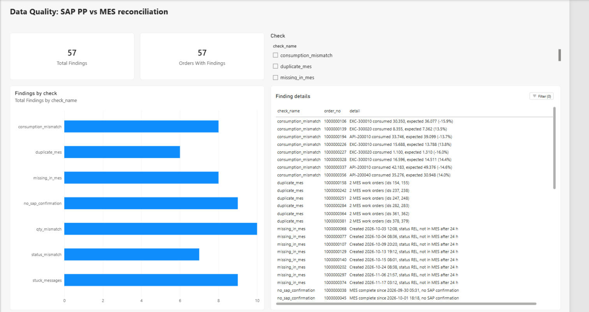

# SAP PP ↔ MES Integration & Data Validation

SQL-based reconciliation of simulated SAP PP and MES data: 7 validation checks, interface exception tracking and OEE reporting, with automated tests. Fictional data.

> **Scope note.** The data is simulated, and the table names are simplified. They are not real SAP tables such as AUFK, AFRU or RESB, and there is no live SAP or MES connection. The project shows the reconciliation logic and the testing approach a manufacturing IT or MES engineer would use.

## What it shows

| Area | What's in it |
|---|---|
| **Simulated systems** | SAP-side production orders, BOM components and confirmations, and MES-side work orders, production records and material consumption, for **400 fictional orders** |
| **Interface log** | IDoc/API-style message log (LOIPRO order download, CONF confirmation, MBGMCR goods issue) with processed, error and pending states, retry counts and error text |
| **7 validation checks** | SQL views: missing in MES, no SAP confirmation, duplicate MES orders, quantity mismatch, consumption mismatch, status mismatch, stuck messages |
| **Known-answer testing** | The generator injects **57 known problems**. The tests prove each check finds exactly those orders, with no misses and no false alarms |
| **Reporting** | Weekly interface health and OEE (availability × performance × quality) views, exported as CSVs for Power BI |
| **Runbook** | [Troubleshooting Playbook](docs/Troubleshooting_Playbook.md) with investigation steps for each check, and a [Power BI Guide](docs/PowerBI_Guide.md) |

## The seven checks

| # | Check | Finds | Injected |
|---|---|---|---|
| 1 | `missing_in_mes` | Released in SAP more than 24 h ago, never arrived in MES | 8 |
| 2 | `no_sap_confirmation` | Complete in MES, no confirmation in SAP | 9 |
| 3 | `duplicate_mes` | Same SAP order downloaded into MES more than once | 6 |
| 4 | `qty_mismatch` | MES good/scrap ≠ SAP confirmed yield/scrap | 10 |
| 5 | `consumption_mismatch` | Component usage more than ±5 % from BOM, scaled to the quantity produced | 8 |
| 6 | `status_mismatch` | SAP CNF/TECO but MES not complete, or SAP still REL after confirmation | 7 |
| 7 | `stuck_messages` | Latest attempt pending more than 60 min, or failed with no retries left | 9 |

Thresholds live in the `validation_settings` table, so they can be tuned without changing the SQL.

The data also contains situations that **must not** be flagged, and the tests check this:
- orders created within the last 24 h that are still on their way to MES
- interface messages that failed with a transient error and then succeeded on retry
- consumption that differs from the BOM by less than 5 %

## Example output

```
$ python -m sapmes.run_validation
Check                   Findings
--------------------------------
missing_in_mes                 8
no_sap_confirmation            9
duplicate_mes                  6
qty_mismatch                  10
consumption_mismatch           8
status_mismatch                7
stuck_messages                 9
--------------------------------
Total                         57

qty_mismatch:
  1000000061  MES good/scrap 119981.000/1713.000 vs SAP 116651.000/1713.000
consumption_mismatch:
  1000000106  EXC-300010 consumed 30.350, expected 36.077 (-15.9%)
stuck_messages:
  1000000011  MBGMCR MES_TO_SAP ERROR, retries 3, ...: Order is locked for confirmation (status TECO)
```

## Project structure

```
sql/
  01_schema.sql             SAP, MES and interface tables
  02_validation_views.sql   the 7 checks + combined findings and summary
  03_reporting_views.sql    weekly interface health and OEE
sapmes/
  generate_data.py          builds clean data, injects the 57 problems
  run_validation.py         prints the summary and example findings
  export_reports.py         writes the 4 CSVs to exports/
  db.py                     connection settings (MES_DB_* variables)
tests/
  test_validation.py        12 tests
exports/                    CSVs for Power BI
powerbi/                    Power BI report (.pbix) and Power BI Project (.pbip)
docs/                       Troubleshooting playbook, Power BI guide, screenshots
```

## Run it

Requires Python 3.10+ and PostgreSQL 14+.

```bash
python -m venv .venv
.venv\Scripts\activate            # Windows  (macOS/Linux: source .venv/bin/activate)
pip install -r requirements.txt
copy .env.example .env            # then set MES_DB_PASSWORD

python -m sapmes.generate_data    # creates the database if needed and loads the data
python -m sapmes.run_validation
python -m sapmes.export_reports
pytest -v
```

The tests use a separate database, `sap_mes_validation_test`, and rebuild it on every run.

**Windows note:** if the `psycopg-binary` DLL is blocked (for example by Smart App Control), add `PSYCOPG_IMPL=python` to `.env`. `db.py` then uses `libpq.dll` from the local PostgreSQL install.

## Power BI dashboard

`powerbi/SAP_MES_Validation.pbix` is a three-page report built on the four CSVs in `exports/`. The same report is also saved as a Power BI Project (`SAP_MES_Validation.pbip`), whose TMDL and JSON files are readable in a git diff.

**Data Quality**: findings per check, with a drill-down table


**Interface Health**: weekly success rate per message type, and processed, error and pending attempts


**OEE**: availability × performance × quality by line and week


The data source paths point to `C:\GitHub\SAP-MES-Integration-Validation-\exports\`. If you clone the repository somewhere else, change them in **Transform data → Data source settings → Change Source**, then click **Refresh**. The measures are described in the [Power BI Guide](docs/PowerBI_Guide.md).

## Skills demonstrated

SQL (CTEs, window functions with `DISTINCT ON`, set-based reconciliation) · PostgreSQL · Python test data generation · pytest known-answer testing · SAP PP and MES integration concepts (order download, confirmations, goods movements, IDoc monitoring) · OEE · interface support runbooks
